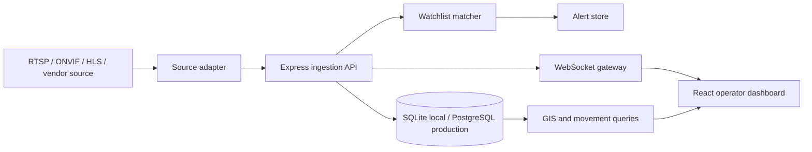

# Sentinel architecture

The local prototype uses SQLite and an Express API so a reviewer can run it without external infrastructure. The relational schema, foreign keys, indexes, and event contracts are PostgreSQL-compatible. In production, SQLite is replaced by PostgreSQL/PostGIS, the adapter boundary is backed by FFmpeg/GStreamer for RTSP-to-HLS/WebRTC, and Redis Streams or Kafka can sit between ingestion and correlation for regional fan-out.

## Security boundary

- JWT authentication is required for all domain APIs.
- Admin-only routes protect camera registry changes, watchlist writes, and audit inspection.
- Passwords are bcrypt-hashed with salted rounds.
- Stream endpoint references are stored as metadata; credentials should be injected from a secret manager.
- Detection `source_event_id` is unique to prevent duplicate ingestion.
- Audit rows record actor, action, resource, details payload, and timestamps for immutable compliance.
- Rate limiting protects `/api/auth/login` (brute-force defense) and `/api/detections` (burst edge traffic protection).
- Deploy behind TLS, reverse proxy (NGINX / Cloudflare), and VPC network segmentation.

## Scale path

Edge gateways should decode and sample video near cameras, publish validated inference events to regional queues, and avoid streaming raw full-resolution video to the central region.

- **GPU & Accelerator Inference Workers**:
  - Deploy edge inference nodes on NVIDIA Jetson Orin (at junctions/RTO posts) or cloud GPU worker pools (`g4dn.xlarge` / `g5.2xlarge` with TensorRT and ONNX Runtime).
  - YOLOv8/v11 ANPR models running at 30 FPS with batched tensor inference, sending only JSON metadata + cropped plate bounding boxes.
- **Monitoring & Logging**:
  - Prometheus metrics exposed via `/metrics` tracking `http_requests_total`, `ingestion_latency_seconds`, `ws_active_clients`, and `active_alert_gauge`.
  - Grafana dashboards for cluster health, camera availability %, and ANPR confidence percentiles.
  - Pino/Winston structured JSON logs aggregated into Vector / Loki / OpenSearch.
- **High Availability & Disaster Recovery (HA/DR)**:
  - Multi-AZ Amazon Aurora / Managed PostgreSQL with continuous WAL archiving to S3 for point-in-time recovery (PITR).
  - pgBouncer for high-concurrency connection pooling.
  - Warm cross-region standby replicas with automated DNS failover under 30 seconds.
- **Infrastructure Cost Ballpark**:
  - **10-camera edge pilot**: ~$350–$550/month (2x NVIDIA T4 `g4dn.xlarge` GPU instances for ANPR inference, 1x `t4g.medium` API server, managed PostgreSQL db.t4g.small, S3 storage).
  - **100-camera regional deployment**: ~$2,800–$4,200/month (8x NVIDIA A10G `g5.2xlarge` GPU workers, Multi-AZ Aurora PostgreSQL cluster, managed Redis ElastiCache cluster, Application Load Balancers, and CloudFront CDN for HLS video distribution).
